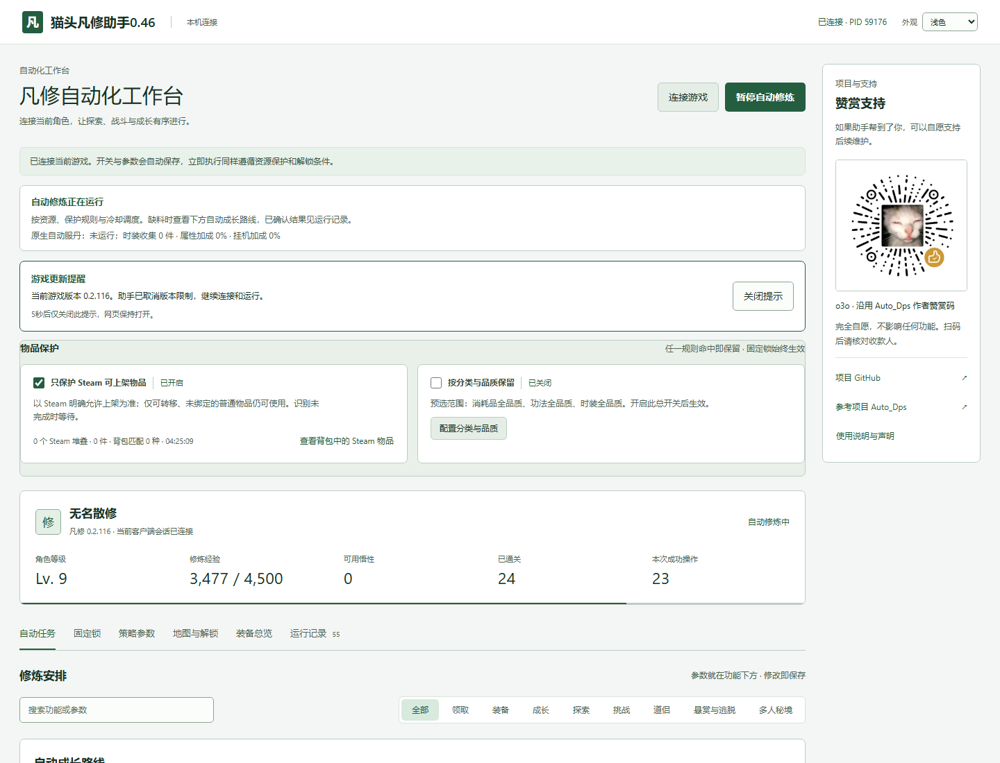

# 猫头凡修助手 0.46 · Auto_fanxiu

连接本机凡修客户端的网页成长助手。43 项可配置任务按实时等级、解锁、库存与保护规则调度；领取、换装、修炼、合成、炼化、世界补料和挑战联动，游戏原生确认后才计为成功。只监听本机回环地址，不建立第二套游戏登录。

[项目 GitHub](https://github.com/weixiao030/Auto_fanxiu) · [版本发布](https://github.com/weixiao030/Auto_fanxiu/releases) · [全部参数](PARAMETERS.md) · [验证记录](VALIDATION.md)

本轮适配游戏 **0.2.116**、桥接 **44**，修复低等级化物批量拒绝、突破失败补偿、永久增益判定和多人秘境指令确认；新增原生自动服丹协调、时装加成展示与运行等待原因。详见 [适配说明](UPDATE_0.2.116.md)。

当前 0.46 正在进行独立的连续30分钟实机验收；完成前不声明完整成长验收通过。多人秘境完整场次等受角色与开放资格限制的分支，单独记录覆盖范围。

界面右侧加入 [Auto_Dps](https://github.com/weixiao030/Auto_Dps) 作者赞赏码，可点击放大；小屏移至内容下方。声明首次提醒、3秒后可记住已读，也可暂时关闭或随时重看。赞赏完全自愿，不影响功能。本项目免费开源，原创源码使用 [Apache-2.0](LICENSE)。



## 双击使用

1. 双击 `猫头凡修助手0.46.exe`。助手自动定位已运行游戏或 Steam 游戏库；找不到时选择包含 `run.exe` 的凡修安装目录。
2. 默认浏览器打开本机工作台。助手只监听 `127.0.0.1:17321`，不会把本机服务开放到局域网。
3. 首次会检测游戏目录、备份 `override.cfg`，并加入桥接加载项。默认禁止重开游戏。已有会话的自有桥接在空闲边界更新，不取消原生排队、不启动第二实例。尚未加载桥接的客户端需等用户日后正常启动游戏，助手不会替用户重开。
4. 双击启动后，就绪即自动开始修炼；也可在网页暂停或恢复。暂停只停止后续派发，已经提交的操作仍等待游戏结算。
5. 重复打开同版本EXE会复用已有本机工作台；打开新版会等待结算后安全接替验证过的旧助手，不结束游戏或Steam。移动 EXE 不影响已安装资源的固定路径。

助手配置与资源保存在 `%LOCALAPPDATA%\FanxiuAssistant\`，不写入 EXE 所在目录。新用户从代码默认值开始，已有用户保留其配置。发布包不携带开发者的配置、游戏数据、配对密钥或恢复源码。

## 默认策略

| 参数 | 首次运行默认值 |
| --- | --- |
| 只保护Steam可上架物品 | **开启** |
| 按分类品质保留 | **关闭**，预选消耗品、功法、时装全品质 |
| 境界突破目标成功率 | **54.5%**，只有一个目标；旧配置保留原实际目标 |
| 自动找料 / 用丹药提概率 / 炼丹 / 服丹 | 默认开启，丹药设置单独展开；按需可关闭 |
| 突破炼丹额外原料保留 | 0；仍预留突破本身用料和所需突破丹原料 |
| 悟性保留 | **0，全部化物** |
| 全局操作间隔 | 3秒 |
| 换装策略 | 原生固定属性比较：任何属性下降不换，保持武器类型，补空槽 |
| 权重评分方案 | 默认关闭；可选开启，最低增益2%，各属性权重可配置 |
| 分类模式预选范围 | 消耗品、功法、时装，全品质；装备、材料不选 |
| 背包自动刷新 | 开启，每60秒；可设5至3600秒或手动刷新 |
| 强化材料保留 | 每种0 |
| 闲置装备合成品质上限 | 至宝 |
| 世界探索间隔 / 每日上限 | 15秒 / 50次 |
| 地图坐标上限 | 20 |
| 免费次数后使用传闻 | 开启，保留1份；窥真镜默认开启 |
| 炼丹材料保留 / 单批 | 每种5 / 1颗 |
| 丹药保留 / 功法加速页保留 | 每种0 / 2页 |
| 炼器材料保留 / 最大投入 / 目标等级 | 每种0 / 50件 / 1级 |
| 强化材料合成保留 / 单批 | 每种2 / 5份，仅补穿戴装备缺口 |
| 资源打包 | 默认关闭；每包4份、原料保留100、每批1包；可限定原料编号 |
| 挑战 / 突破秘境失败等待 | 180秒 / 600秒；危险秘境默认开启 |
| 炉鼎经验领取门槛 | 1 |
| 迁居令保留 / 最低收益提升 | 1份 / 5% |
| 断线恢复 | 开启，等待60秒后重试，指数退避 |
| 允许重开游戏 | **关闭**，保留当前游戏会话与原生队列 |
| Steam自动更新 | 保留开关；禁止重开时不触发关闭、下载后重开或断线重开 |

当前代码默认值为强化额外保留0、炼化和过时材料额外保留0、强化材料合成保留2；旧用户的既有设置沿用，不在升级时强行覆盖。突破、强化与炼丹实际需求预算独立生效，避免补料任务互相消耗必需用料。

固定锁和游戏内锁始终有效，两项保护总开关都关闭也不能使用、替换、强化或合成锁定物品。两套保护可以独立开关，同时开启取并集。默认只开启Steam保护；分类模式预选消耗品、功法、时装的九种品质，启用后生效。游戏原生优先扣绑定，所选保护范围内可消耗绑定预算，受保护未绑定数量不消耗；混合库存本身不再阻塞任务。未知品质按已选分类保留。

Steam保护仅依据SDK明确的`marketable=true`上架属性；仅可转移（`tradable=true`）不触发该保护。Steam标记来自游戏已初始化的只读GodotSteam库存接口与物品定义目录，不依赖“未绑定”等同“Steam可交易”，无需登录另一个账号。功法按编号和层数映射；时装按实例对应的配置编号映射，不能把服务器实例编号当作Steam定义编号。本次0.2.116的954个SDK定义目录没有装备类；游戏普通装备按其固定锁和分类规则处理。接口或映射未知时保守保留。网页分别展示Steam堆叠/件数与游戏背包匹配种数，匹配列表不冒充完整Steam库存。

支持9种品质：凡品、下品、中品、上品、极品、仙品、完美、先天、至宝。

## 43项任务

每项有独立开关和“立即执行”，配置参数位于所属按钮下。正在操作或战斗时，其他任务可点击“排队执行”，再次点击取消排队；同项不重复提交。执行前重新检查最新解锁、材料、保护和条件，任务开启不代表无条件执行。暂停、客户端更换或未确认结算会取消尚未提交的队列，队列不跨重启恢复。

| 分类 | 任务 |
| --- | --- |
| 领取补给 | 领取修炼收益、挂机掉落、邮件附件、开启资源箱、领取炉鼎经验 |
| 装备炼器 | 择优换装、强化装备、闲置装备合成、盈余材料炼化、世界熔炉炼化、强化材料合成、资源打包 |
| 修炼成长 | 检查升级、境界突破、激活功法、配置主动功法、功法修炼、功法加速、使用成长丹药、自动炼丹 |
| 世界探索 | 世界同步、世界探索、资源采集、据点与灵泉、处理奇遇、清理失效坐标、择优迁居 |
| 挑战挂机 | 挑战下一关、突破秘境挑战、选择刷图关卡、悟性化物 |
| 道侣社交 | 道侣同步、双修、定向结缘、道侣解救 |
| 抓捕悬赏 | 主动抓捕、玩家占领、悬赏同步、悬赏挑战、被捕悬赏求援、被捕自动逃脱 |
| 资源与多人秘境 | 资源秘境补给、多人秘境托管 |

道侣目标留空时不结缘；只对用户填写的数字好友编号邀请或接受，两个行为开关默认关闭，不随机邀请、不自动聊天。双修用户上限默认10次，同时遵守服务器的更低上限。

主动抓捕与占领每日最多各3次尝试，要求无伤势、战力为碾压或优势；占领要求已知洞府属性且收益提升至少5%。同一目标失败后等待900秒，目标身份在执行前再次校验。

悬赏同步默认180秒，每日最多5次挑战尝试；默认允许挑战符合条件的玩家悬赏。被捕自动发布悬赏另有开关，默认关闭，并保留1份悬赏令。逃脱默认先符后普通尝试；普通逃脱失败可能延长囚禁，每次被捕仅提交一次普通尝试，重启仍去重。道侣解救默认仅使用脱身符并保留1份，所有适用消耗遵守交易保护。

多人秘境按当前游戏的真实开放时间与角色资格运行；默认不自动入场。开启自动入场后免费次数优先，用尽后再检查钥匙的绑定预算、固定锁和保护。探索、事件与战斗指令沿用原生票据和结果核对；未确认不计成功。默认探索低血撤离40%、时长上限900秒。战斗逃脱阈值25%只在原生支持时显示；当前0.2.116不支持该接口，战斗等待原生结算。需要真实可进入场次才能验证完整托管，隔离分支通过不等于已实机走完。

## 界面与运行

支持分类、搜索、折叠，浅色/深色/跟随系统。固定锁页显示当前角色真实背包图片、名称、等级、数量和绑定份；图标从本机已安装游戏读取，不随EXE分发。可以按等级、品质、数量、名称升降序排序，或恢复游戏顺序；浏览器记住排序选择，没有等级和未知品质的物品置后。上锁按物品编号（功法含层数）保留，暂时不在背包的锁记录也保留，只有显式解除才取消。其他页签修改策略会同步；单字段编辑由服务端合并到最新配置，旧格式整份写入须刷新网页后再提交；聚焦输入和未保存的权重草稿不会被远程覆盖。化物卡片显示悟性余额、保留量、消耗、可执行次数及等待原因。装备合成卡显示同品质可用数量和保护原因，背包总量提醒不代表有足够可用原料。

资源打包有原料损耗，只能使用未锁定的可交易原料；该原料分类和品质被交易保留时暂停。支持4/20/100份规格、原料保留、单批上限和原料编号限制，同时遵守服务器每日额度。开启自动打包后不再自动拆资源包，避免反复打包损耗；装备箱仍按原有规则处理。

本机HTTP通信显式直连回环地址，不经过系统HTTP代理；不会修改代理注册表、环境变量、路由或加速器配置。Steam更新检查继续使用系统网络设置。连续三次本机健康检查失败会重新绑定监听，保留现有任务、队列和保护状态，不因恢复本机网页而重启游戏。

网页状态请求不会重叠，响应有超时和自动重试。心跳延迟8至30秒保持会话并等待新状态，期间不按旧状态重启或执行排队任务；超过30秒进入断线恢复。短暂网页读取失败保留现有配置，过期状态暂停按钮提交，恢复后自动启用。

服务器明确返回繁忙时，所有任务共同退避30秒，避免其他任务继续挤占请求；排队任务显示等待秒数，退避后再按最新条件派发。服务器拒绝和正常战败如实记为未成功。

成功次数来自游戏确认的操作批次，重启本机服务后重新计数；每日已知探索次数、抓捕等尝试计数和被捕去重记录会持久保存；接入前的手动道具探索未必有完整可用历史，不把已知次数当成所有客户端的全量账本。正常战败、服务器繁忙和条件不足如实显示，不计为成功。结果未确认或会话冲突时停止后续自动化，不抢登、不重复提交同一战斗结算。

断线由原客户端恢复会话，助手继续等待。默认禁止重开；桥接升级、心跳断开和Steam更新都不得关闭或重启游戏。自动恢复任务与允许重开是独立开关。助手不再按游戏版本或文件哈希阻止连接。游戏更新时只显示5秒提醒，可手动关闭；只关闭提示，网页保持打开。未来接口变化仍可能需要适配，游戏服务器要求更新时仍由Steam完成更新。

## 验证边界

已接入、隔离测试通过和实机触发是不同的证据。完整矩阵及最终验收结论见 `VALIDATION.md`，历史修复见 `MODLOG.md`。

道侣双修与状态同步、悬赏同步已在当前客户端得到真实成功结果；修订11已真实完成怪物悬赏战斗胜利和服务器领奖确认。抓捕、占领、解救、悬赏战斗、被捕求援/逃脱等受当前角色状态、目标与资源限制，部分分支只有隔离测试。多人秘境完整场次尚未实测。不能据此宣称全游戏后期所有分支均已实机通过。

## 文件、备份与卸载

EXE用户数据目录：

- `resources/web/`、`resources/bridge/`：持久网页及桥接资源。
- `runtime/config.json`：用户策略；`daily.json`：每日尝试数；`capture-actions.json`：被捕动作去重。
- `runtime/bridge.key`：本机配对密钥，请勿分享。
- `backups/`：安装前游戏设置和资源备份。

停止使用：在网页暂停，等待当前操作结算后结束“猫头凡修助手”进程。卸载桥接无需 Python：正常退出游戏，用记事本打开游戏目录 `override.cfg`，只删除从 `; FANXIU_ASSISTANT_BEGIN` 到 `; FANXIU_ASSISTANT_END` 的整个助手标记块，保留其他设置；保存后从 Steam 启动游戏。原设置备份保留在上述 `backups/`。已被服务器确认的游戏操作不会因卸载回滚。

## 源码运行、构建与复验

Windows 10/11 x64、Python 3.10+（含 Tk）用于开发；发行 EXE 自带运行时。前端是原生 HTML/CSS/JavaScript，无需 npm 构建。完整开发检查还需要 Node.js 和独立 Godot 兼容测试引擎。

```powershell
python -m pip install -r requirements-dev.txt
python -m playwright install chromium
# 源码开发入口，会定位本机已安装游戏并复用当前客户端
python -X utf8 desktop_entry.py
# 仅 Python 回归，不操纵真实游戏
python -X utf8 -m unittest discover -s tests -q
```

Godot 桥接检查使用自己编写的隔离夹具，没有游戏单例、登录或网络。测试引擎不随项目分发；将独立 Godot 4.7+ 兼容引擎绝对路径设为环境变量，或预置 `.private/bridge-lab-engine.exe`。当前实测引擎为 Godot 4.8.dev；如使用 GDRE 测试引擎，保留其配套 DLL。不能将游戏 `run.exe` 作为测试引擎。

```powershell
$env:FANXIU_TEST_ENGINE = 'C:\Tools\Godot\godot.exe'
python -X utf8 tools/check_all_logic.py
# 自动递增应用版本、构建候选，不覆盖正式 dist
python -X utf8 tools/build_exe.py --candidate --candidate-dir .private/release-candidate
python -X utf8 tools/verify_exe.py --exe '.private/release-candidate/对应版本.exe'
# 部署候选且当前游戏连接就绪后，界面检查只读，不提交游戏操作
python -X utf8 tools/validate_growth_ui.py
python -X utf8 tools/validate_project_ui.py
python -X utf8 tools/monitor.py --seconds 1800 --period 10 --candidate-dir .private/release-candidate
```

`tools/audit_native_contracts.py --native-root <本地私有恢复目录>` 是维护者可选的原生签名检查；仓库不提供恢复游戏源码，普通运行与隔离回归不依赖它。正式发布还需该报告、当前指纹的全部检查和真实成长资源交接证据；通过后使用 `tools/build_exe.py --acceptance <验收目录> --candidate-dir <候选目录>` 与 `tools/release_growth.py --acceptance <验收目录/result.json>` 生成同哈希包。

最终候选须连续至少30分钟实机监控。修复分发源码后重新构建、重新计时；模拟、短时观察、检查点和历史版本不替代本版验收。发布工具不把动作计数当成炼化→实际强化/突破的资源因果链。

游戏程序、恢复源码、美术、用户配置与配对密钥仅留在本机私有目录，不随仓库或 EXE 发布。开发依赖见 `requirements-dev.txt`，第三方资源归属见 [THIRD_PARTY_NOTICES.md](THIRD_PARTY_NOTICES.md)。

## 自动突破说明

修为满、可用材料齐全、当前成功率下限达到目标后才会提交原生突破。自动找料在自动挂机模式下优先选择有对应缺料掉落的已通关关卡，补齐后恢复最高关卡；指定关卡时不自动换图。随机掉落不保证固定时间补齐。普通炼丹和炼器会预留突破本体材料，关闭丹药提概率也不会撤掉这份预留。只有成功率不足且相应开关开启，才炼制或使用当前境界突破丹。每次只处理一颗，等待游戏确认后重算。

## 世界探索等待原因

免费额度按香港时间UTC+8刷新，道具单次成本随当天使用变化。免费用完后才按开关和保留量考虑流言、窥真镜。原生先扣绑定，执行前核对绑定预算至少支付本次真实成本，扣后总量至少达到保留值；未绑定保护份作为不可消耗底线。网页列出数量、绑定份、可用预算、成本、保留量以及具体等待原因。重新有免费额度或合格资源时自动恢复。
